# Spesifikasi — HRIS PT. SMP

Stack: **React + TypeScript (Vite, web app responsif + PWA) + Supabase (region Singapore)** (Auth, Postgres, Storage, Realtime, pg_cron). Hosting: Vercel.
Status: tahap desain selesai (UML + ERD). Berikutnya: setup Supabase.
Dokumen terkait: `prd.md`, `security.md`.

---

## 1. Aktor & hak akses

| Aktor | Mewarisi | Ringkasan akses |
|---|---|---|
| Karyawan | Pengguna | Clock in/out (selfie), riwayat absensi, ajukan lembur & cuti/sakit/izin, batalkan pengajuan (selama menunggu), lihat status, unduh slip gaji |
| Atasan | Karyawan | + Persetujuan tingkat 1 untuk pengajuan bawahan, lihat absensi tim |
| HR / Admin | Karyawan | + Persetujuan tingkat 2, kelola data karyawan, koreksi absensi, kelola master data, proses payroll, lihat & unduh semua laporan |
| Direksi | Pengguna | Tidak clock in, tidak menerima slip. Menyetujui pengajuan Atasan & HR, menyetujui payroll, lihat & unduh semua laporan, mengelola akun HR (angkat / ganti / nonaktifkan) |

**Alur persetujuan (lembur & cuti sama):**

| Pengaju | Tingkat 1 | Tingkat 2 |
|---|---|---|
| Karyawan | Atasan | HR |
| Atasan / HR | Direksi | — |

Ditolak di tingkat mana pun → status langsung ditolak.

---

## 2. Aturan bisnis

### Jadwal kerja
- 6 hari kerja, total 40 jam/minggu:
  - Senin–Jumat **07:00–15:00** (7 jam kerja + 1 jam istirahat)
  - Sabtu **07:00–12:00** (5 jam, hari kerja terpendek)
- Jam masuk & jam pulang diatur **per hari** di master data.
- Tanggal merah dikelola HR di tabel `hari_libur`.

### Absensi
- Satu kali clock in & satu kali clock out per hari, **wajib foto selfie** dari kamera langsung (disimpan di Supabase Storage, tabel menyimpan **path**).
- Jam diambil dari **server** (`now()`), bukan perangkat.
- Status **terlambat** otomatis (trigger) jika clock in > jam masuk jadwal.
- **Lupa clock out** → job `pg_cron` tengah malam mengisi jam keluar = jam pulang standar, `auto_clock_out = true`.
- **Koreksi oleh HR**: HR dapat menambah/mengubah absensi (mis. HP rusak) dengan `alasan_koreksi` wajib; tercatat di `log_audit`.
- **Retensi selfie 12 bulan**: file dihapus otomatis, data jam tetap disimpan.

### Lembur (Opsi A)
- Diajukan **sebelum lembur**. Batas: hari kerja → paling lambat **jam pulang di hari yang sama**; hari libur → paling lambat **sebelum jam mulai lembur**.
- Tidak ada clock in ulang; karyawan clock out sekali di akhir lembur.
- Jam dibayar = **min(jam aktual, jam disetujui)**.
  - Hari kerja: jam aktual = clock out − jam pulang standar.
  - Hari libur: jam aktual = clock out − clock in (seluruhnya lembur).
- Upah sejam = **1/173 × gaji pokok** (tunjangan makan/transport bukan tunjangan tetap).
- Tarif (PP 35/2021, pola 6 hari kerja):
  - Hari kerja: jam ke-1 = 1,5×, jam berikutnya 2×.
  - Hari istirahat/libur resmi: jam ke-1–7 = 2×, jam ke-8 = 3×, jam ke-9–11 = 4×.
  - Libur resmi jatuh di hari kerja terpendek (Sabtu): jam ke-1–5 = 2×, jam ke-6 = 3×, jam ke-7–9 = 4×.
- Hanya lembur berstatus disetujui yang masuk payroll.

### Cuti / sakit / izin
- Lampiran (mis. surat dokter) **opsional**.
- Jatah cuti tahunan **sama untuk semua karyawan** (di `pengaturan`).
- **Reset setiap 1 Januari**, sisa tahun sebelumnya **hangus**.
- **Karyawan baru**: jatah = jatah tahunan × (bulan penuh tersisa ÷ 12), dibulatkan ke bawah. Contoh: jatah 12, masuk 15 Maret → 9 hari.
- Hari dihitung **hari kerja saja** (Senin–Sabtu, tanpa tanggal merah).
- Hanya **cuti** yang memotong saldo; sakit & izin tidak.
- **Cuti bersama** (ditandai HR di `hari_libur` dengan `jenis = cuti_bersama`) memotong saldo 1 hari per tanggal untuk semua karyawan aktif; saldo tidak bisa minus; tanggal itu bukan hari kerja.
- Saldo dicek saat pengajuan (kurang → ditolak sistem), dan **dikurangi setelah disetujui**.
- Status pengajuan: menunggu, disetujui, ditolak, dibatalkan.

### Payroll
- Periode **26 – 25**, label bulan = bulan tanggal 25 (26 Des – 25 Jan = Januari tahun baru).
- Rumus:
  - Tunj. makan = tarif makan/hari × hari hadir (tarif diisi manual HR)
  - Tunj. transport = tarif transport/hari × hari hadir (tarif diisi manual HR)
  - **Jumlah gaji** = gaji pokok + upah lembur + tunj. makan + tunj. transport + pendapatan lain
  - **Pendapatan bersih** = jumlah gaji − total potongan
- **Hari hadir** = jumlah hari kerja (Senin–Sabtu, bukan tanggal merah) yang memiliki absensi. Lembur di hari libur tidak menambah hari hadir.
- **Pembulatan**: upah sejam dibulatkan ke rupiah terdekat; upah lembur per pengajuan = total pengali × upah sejam, dibulatkan ke rupiah terdekat.
- Pendapatan lain diisi manual HR. Potongan diisi manual dengan kategori: **alpha, terlambat, kasbon**.
- Tanpa PPh 21 & BPJS (tahap awal).
- Status: draft → diajukan → (revisi → diajukan) → **final** (dikunci).
- Nilai gaji pokok & tarif **disalin** ke slip saat dibuat (slip lama tidak berubah).
- Slip PDF dibuat di **React** (`@react-pdf/renderer`) saat diunduh; tidak dikirim email (bisa ditambah nanti via Edge Function).

### Karyawan nonaktif
- Resign → `aktif = false` sejak tanggal efektif, akun di-ban di Auth, tidak bisa login. Data & slip tetap tersimpan; HR dapat mengunduhkan bila diminta. Pengajuan berstatus Menunggu dibatalkan otomatis.
- No. KTP tampil tersamar; HR & Direksi bisa "Tampilkan" via RPC `lihat_ktp`, tercatat di `log_audit`.

### Laporan (HR & Direksi)
- Rekap absensi, lembur, dan gaji — **per bulan dan per tahun**.
- Unduh **Excel** (SheetJS) dan **PDF** (`@react-pdf/renderer`).

---

## 3. Use case diagram (PlantUML)

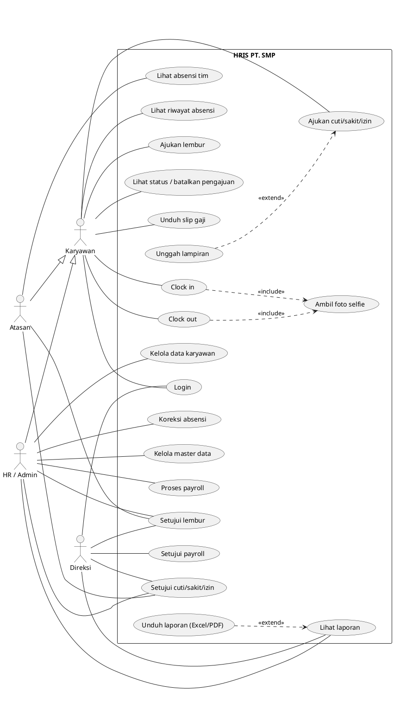

---

## 4. Activity diagram

### 4.1 Absensi (clock in / clock out)
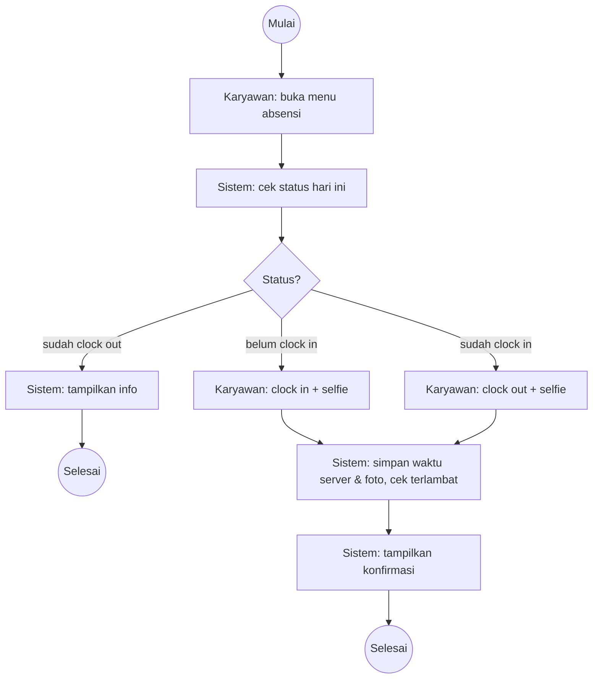

### 4.2 Pengajuan lembur
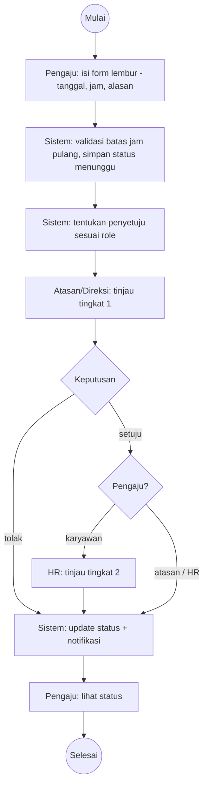

### 4.3 Pengajuan cuti / sakit / izin
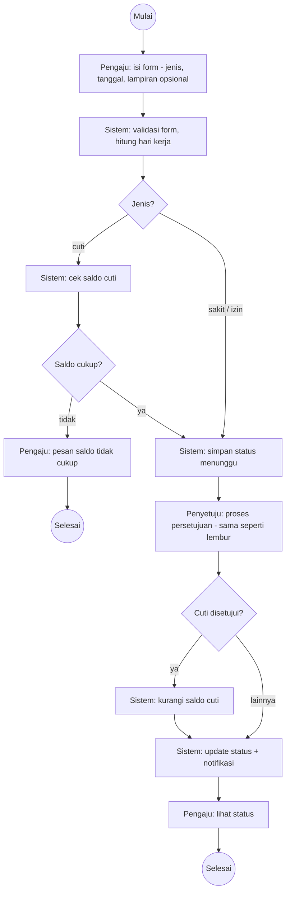

### 4.4 Payroll
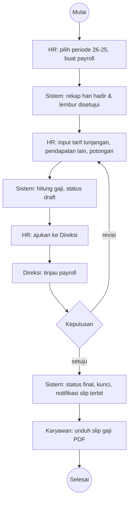

---

## 5. Sequence diagram

### 5.1 Clock in
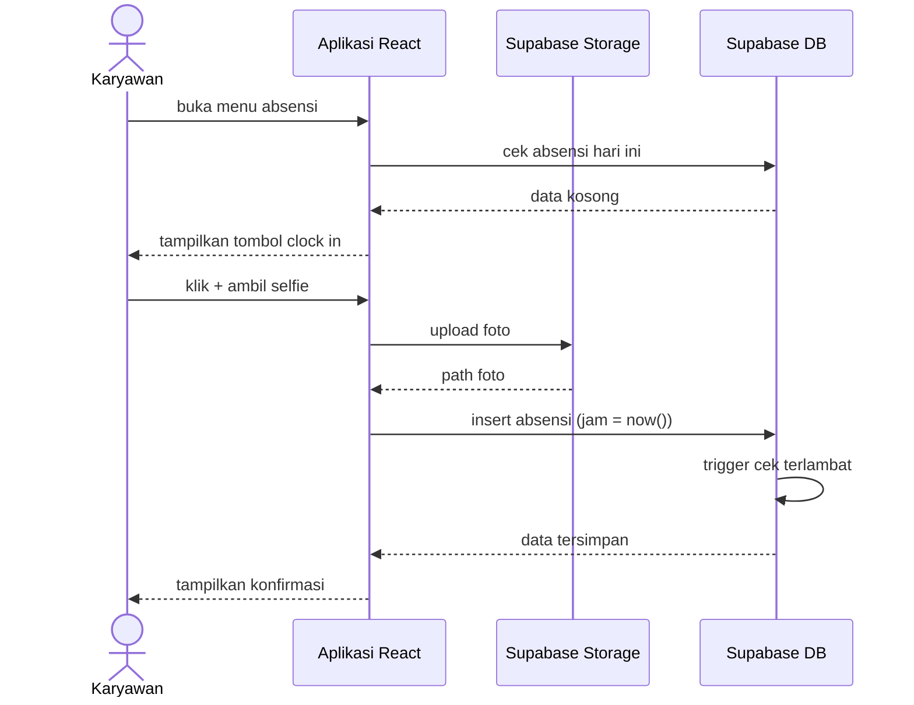
Clock out sama, dengan *update* jam keluar. Auto clock out dijalankan `pg_cron` tiap tengah malam.

### 5.2 Pengajuan & persetujuan lembur
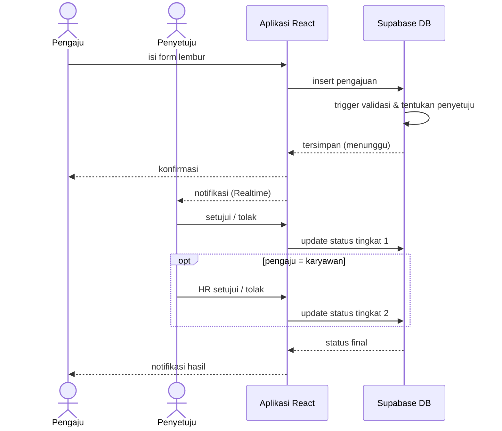

### 5.3 Pengajuan cuti / sakit / izin
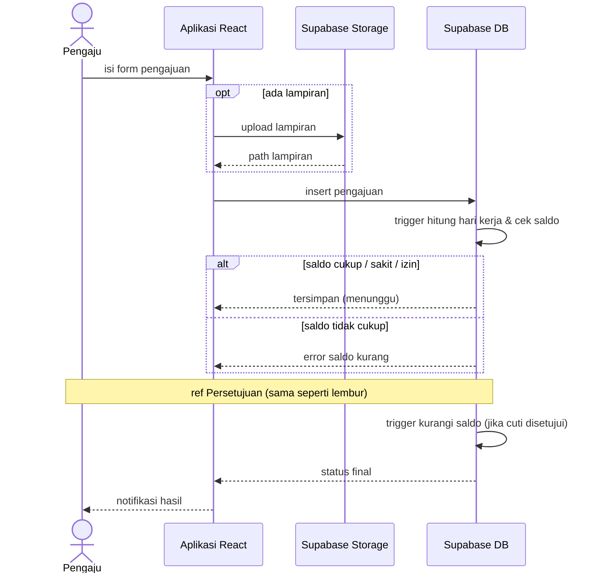

### 5.4 Payroll
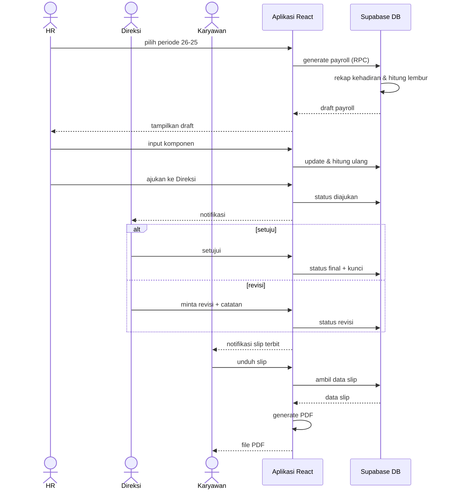

---

## 6. Class diagram
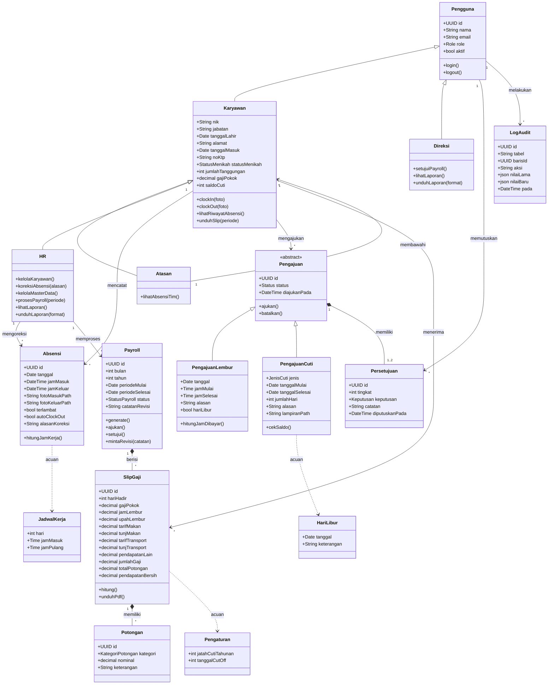

---

## 7. ERD (nama tabel & kolom Bahasa Indonesia)
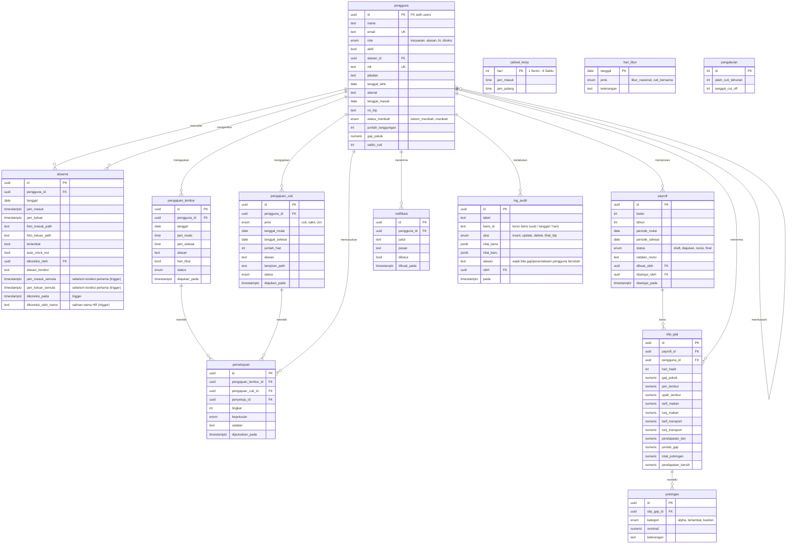

### Constraint penting
- `absensi`: UNIQUE (`pengguna_id`, `tanggal`); jika `dikoreksi_oleh` terisi maka `alasan_koreksi` wajib (CHECK)
- `payroll`: UNIQUE (`bulan`, `tahun`)
- `slip_gaji`: UNIQUE (`payroll_id`, `pengguna_id`)
- `persetujuan`: CHECK tepat satu dari `pengajuan_lembur_id` / `pengajuan_cuti_id` terisi
- `payroll` berstatus `final` tidak bisa di-update (dikunci via trigger)
- `log_audit`: hanya diisi trigger, tidak bisa diubah dari client
- Nominal uang: `numeric(14,2)` dengan CHECK `>= 0`

---

## 8. Catatan teknis Supabase
- **Trigger DB**: cek terlambat, validasi batas waktu lembur, routing penyetuju, hitung hari kerja & cek saldo, kurangi saldo saat cuti disetujui, hitung ulang slip saat komponen berubah, isi `log_audit` (pengguna, absensi, status payroll), kunci payroll final.
- **RPC**: `generate_payroll(bulan, tahun)`, `clock_in`, `clock_out`.
- **pg_cron**:
  - auto clock out — setiap tengah malam
  - reset saldo cuti — setiap 1 Januari
  - hapus selfie > 12 bulan — setiap bulan
  - potong saldo cuti bersama — harian, untuk tanggal cuti bersama hari itu
- **Storage**: bucket `selfie` & `lampiran` (privat, signed URL).
- **Realtime**: notifikasi pengajuan, persetujuan, slip terbit.
- **Auth**: tanpa sign up publik; akun dibuat HR via Edge Function (akun HR dibuat Direksi); MFA (TOTP) HR & Direksi.
- **RLS**: lihat `security.md`.
- **Frontend export**: slip & laporan PDF via `@react-pdf/renderer`, laporan Excel via SheetJS.
